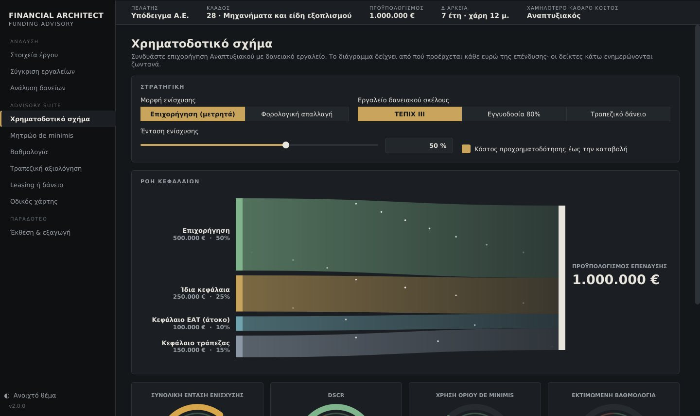
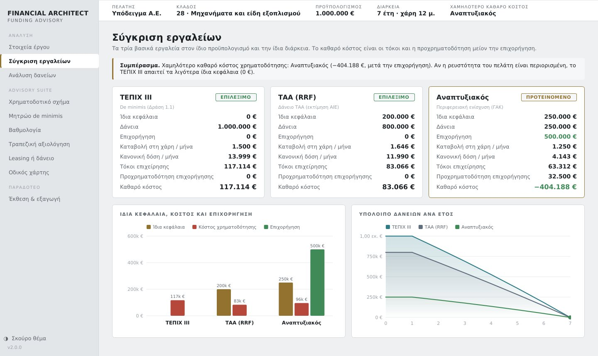

# Financial Architect — Download

Desktop software for funding advisory on Greek and EU programmes. It compares
**TEPIX III**, **RRF loans** and **Development Law grants** on the same basis and builds
the optimal funding mix. It checks the result against de minimis limits, bankability
(DSCR, D/E) and the evaluation score, then produces a client-ready PDF study and an
Excel workbook containing every repayment schedule.

## Download

Go to **[Releases](../../releases/latest)** and download:

* **Windows:** `FinancialArchitect-Windows.zip` → unzip → double-click `FinancialArchitect.exe`.
  If Windows shows "Windows protected your PC", click **More info → Run anyway**.
  This appears because the program is not signed by a registered publisher.
* **macOS:** `FinancialArchitect-macOS.zip` → unzip → right-click **Financial Architect** → **Open**.

No installation and no internet connection are needed. Your case files stay on your computer.

## Notes

* The programme parameters (rates, limits, ΚΑΔ exclusions, scoring weights) were checked in
  October 2026. Results are indicative: always verify them against the current call text.
* The source code is private. This repository contains only the compiled program.
* Portfolio: [ckatsambas.github.io](https://ckatsambas.github.io)

© 2026 Christos Katsampas. All rights reserved. You may download and use the program
to evaluate it. You may not redistribute, modify, decompile or sell it without written
permission. See [LICENSE](LICENSE).
